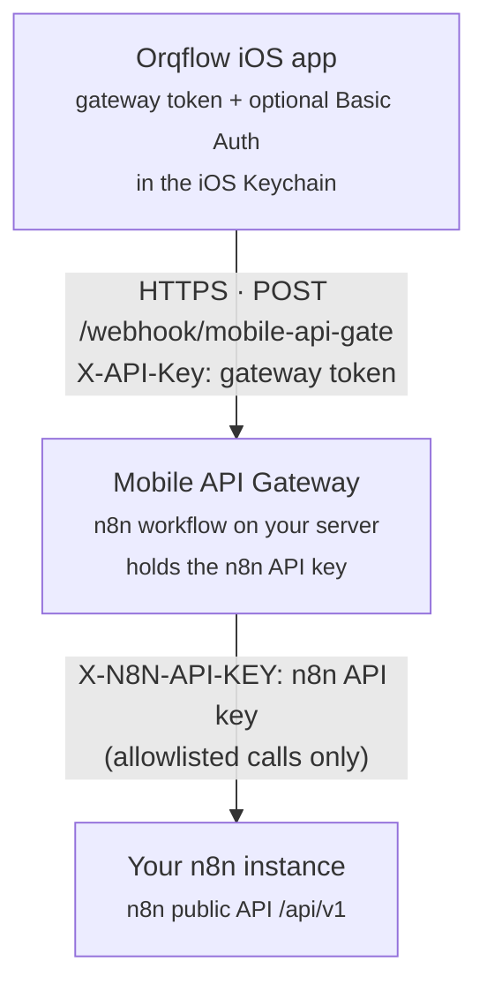

<p align="center">
  <a href="https://apps.apple.com/app/id6810390118">
    
  </a>
</p>

<h1 align="center">Orqflow Mobile API Gateway</h1>

<p align="center">
  Open-source n8n workflow that securely connects your own n8n instance to the <a href="https://shinkarenko.eu/projects/orqflow/">Orqflow</a> app for iPhone and Android.
</p>

<p align="center">
  <a href="LICENSE"></a>
  <a href="https://apps.apple.com/app/id6810390118"></a>
  <a href="https://github.com/shaman-rostov/n8n-mobile-api-gate/releases/tag/android-v1.0.2"></a>
  
</p>

---

## What is Orqflow?

**Orqflow** is an iPhone and Android app for keeping an eye on your n8n automations: see your workflows, switch them
on or off, follow executions and stop one that is stuck — without opening a browser.

**The Mobile API Gateway** (this repository) is the other half. It is a single n8n workflow you import into
*your own* n8n. The app talks to it over HTTPS, and it talks to the n8n API on your server. There is no
Orqflow account and no Orqflow server in between: you keep the infrastructure, the data and the keys.

Orqflow is an independent app. It is not affiliated with, endorsed or sponsored by n8n GmbH.

| Platform | Status |
|---|---|
| iOS (iPhone, iOS 16 or later) | [Available on the App Store](https://apps.apple.com/app/id6810390118), free |
| Android (8.0 or later) | [APK in Releases](https://github.com/shaman-rostov/n8n-mobile-api-gate/releases/tag/android-v1.0.2), free; Google Play in testing |

### Installing on Android

1. Open the [latest Android release](https://github.com/shaman-rostov/n8n-mobile-api-gate/releases/tag/android-v1.0.2) on your phone and download the `orqflow-….apk` file.
2. Open it and allow installing apps from this source when Android asks.
3. Set up the gateway below, then connect the app ([step 8](#8-connect-the-app)).

The APK is signed with a different key from the Google Play build, so one can't update the other:
uninstall the installed version before switching. Android releases are tagged `android-v…`; gateway
releases are tagged `v…`.

## Features

What the app does through this gateway:

- **Workflows** — list all workflows with their tags, search by name, show only active ones, open a
  workflow's details, and switch a workflow on or off.
- **Executions** — history with paging, filters by status (success, error, running, waiting) and date,
  search by execution ID or workflow name, and the runs of a single workflow.
- **Execution details** — status, mode, start and end time, duration; a running execution can be stopped.
- **Live status** — lists refresh on their own while something is running; the Executions tab shows how
  many runs are in progress.
- **Home Screen widget** — the number of active workflows.
- **Connection check** — a test button during setup and in Settings; 11 interface languages.

The app does not edit workflows, read execution data (inputs and outputs of nodes), or manage
credentials, users or variables — and the gateway does not offer those operations.

## Architecture



- The app connects **directly to the n8n address you enter** — nothing passes through a third-party server.
- The gateway runs **inside your n8n**, as an ordinary workflow with one webhook.
- Two different secrets are involved:
  - the **gateway token** authorises the app to the gateway. It is stored in the gateway's ⚙️ Config node
    and, on the phone, in the iOS Keychain; the app sends it with every request;
  - the **n8n API key** authorises the gateway to the n8n API. It is stored only in the ⚙️ Config node on
    your server and is never sent to the app.
- The gateway checks the token first, then maps each request to one fixed n8n API call from a short
  allowlist, and returns JSON.

## Quick start

Setup takes about ten minutes. You need an n8n instance that your iPhone can reach over **HTTPS**.

### 1. Import the workflow

1. Download [`workflow/orqflow-gateway.json`](workflow/orqflow-gateway.json).
2. In n8n: **Workflows → Create → ⋯ → Import from file**, and select the file.

### 2. Create a gateway token

Generate a random token on your computer:

```sh
openssl rand -hex 32
```

Keep it at hand: it goes into the ⚙️ Config node and into the app.

### 3. Create an n8n API key

In n8n: **Settings → n8n API → Create an API key**. If your n8n offers **scopes**, give the key only these:

| Scope | Used for |
|---|---|
| `workflow:list`, `workflow:read` | Workflow list and details |
| `workflow:activate`, `workflow:deactivate` | The on/off switch |
| `execution:list`, `execution:read` | Execution history and details |
| `execution:stop` | Stopping a running execution |
| `execution:delete` | Removing the gateway's *own* past runs (see [Execution history](#execution-history)) |

A key limited this way cannot read credentials, users or variables even if the gateway were misused.

### 4. Fill in the ⚙️ Config node

Open the **⚙️ Config** node of the imported workflow and replace the values:

| Field | What to enter |
|---|---|
| `gatewayToken` | The token from step 2. **Required.** At least 32 characters; the gateway refuses every request while it is empty, too short or still a `CHANGE_ME` placeholder. |
| `n8nApiKey` | The API key from step 3. **Required.** |
| `instanceUrl` | The address at which **n8n reaches itself**, used for the gateway's API calls. The default `http://localhost:5678` works for a standard install, including most Docker setups. This is *not* necessarily the public address you enter in the app. |

### 5. Optional: HTTP Basic Auth on the webhook

The gateway token already protects the webhook. For a second layer:

1. In n8n: **Credentials → Create → Basic Auth**, enter a username and password.
2. Open the **Webhook Gateway** node → **Authentication: Basic Auth** → select that credential.
3. Enter the same username and password in the app's *Basic Auth* fields.

The same fields work if your reverse proxy puts n8n behind Basic Auth.

### 6. Activate the workflow

Save the workflow and switch it to **Active** (top right). Inactive workflows do not answer production
webhooks.

### 7. Check the gateway

```sh
curl -X POST https://n8n.example.com/webhook/mobile-api-gate \
  -H "X-API-Key: YOUR_GATEWAY_TOKEN" \
  -H "Content-Type: application/json" \
  -d '{"action":"list_workflows","params":{"limit":1}}'
```

Expected: `{"success":true,"action":"list_workflows","data":{"items":[…],…}}`. This also proves that
`n8nApiKey` and `instanceUrl` work; see [Troubleshooting](#troubleshooting) otherwise.

### 8. Connect the app

In Orqflow, during onboarding or in **Settings**:

| Field | Value |
|---|---|
| Server URL | Your public n8n address, e.g. `https://n8n.example.com` |
| Gateway Token | The token from step 2 |
| Basic Auth username / password | Only if you set up step 5 |

Tap **Test Connection**, then **Save**.

### Upgrading from an earlier gateway

1. Note your `gatewayToken`, `n8nApiKey` and `instanceUrl` from the old ⚙️ Config node.
2. Deactivate the old workflow, import the new file, and paste the values into its ⚙️ Config node. If
   your old token is shorter than 32 characters, generate a new one and update it in the app too.
3. If you used Basic Auth, select the credential again in the **Webhook Gateway** node.
4. Activate the new workflow and delete the old one.

The current gateway serves only what the app uses. Earlier versions also accepted actions that created,
changed or deleted workflows, credentials, variables, tags and source control; those are gone (see
[Security](#security)).

## Security

The gateway is built to fail closed and to expose as little of n8n as the app needs. That lowers the
risk; it does not remove it — treat the gateway token like a password.

- **Gateway token.** Every request must carry `X-API-Key` with the exact token from the ⚙️ Config node.
  It is checked before anything else, compared in constant time, and the gateway refuses to work at all
  while the token is missing, empty, shorter than 32 characters or a placeholder (`CHANGE_ME…`,
  `change-me`). There is no default token.
- **Allowlist.** Only the nine [supported actions](#supported-actions) exist. Each accepts only its own
  parameters; anything unknown is rejected with `400`. IDs are checked against `[A-Za-z0-9_-]`, so a
  request cannot change the path of the n8n API call. Execution data (`includeData`) is never requested.
- **n8n API key.** Kept in the ⚙️ Config node on your server, used only for calls from the gateway to n8n,
  never returned in a response. Give it the [minimal scopes](#3-create-an-n8n-api-key) where n8n supports
  them.
- **Transport.** The iOS app connects over HTTPS only. Put n8n behind TLS (a reverse proxy such as Caddy,
  Traefik or nginx).
- **Optional Basic Auth** on the webhook adds a second credential.
- **On the phone.** The server address, gateway token and Basic Auth credentials are stored in the iOS
  Keychain, on this device only (`kSecAttrAccessibleAfterFirstUnlockThisDeviceOnly`: not in backups or
  iCloud). The app has no account, no analytics and no third-party SDKs — see the
  [privacy policy](privacy-policy.md).
- **Inside n8n.** The workflow, and the executions n8n saves of it, contain the token and the API key in
  plain text, like any n8n workflow holding a secret. Anyone with access to this workflow or its
  executions in n8n can read them: limit who has access to your n8n, and rotate both secrets if you
  suspect a leak.

Recommendations for your n8n: keep it updated, expose it only over HTTPS, use a strong owner password
(and two-factor authentication), and do not share the gateway workflow with users who should not hold the
API key.

Found a vulnerability? Please report it privately — see [SECURITY.md](SECURITY.md).

## Supported actions

All requests are `POST /webhook/mobile-api-gate` with the headers `X-API-Key: <gateway token>` and
`Content-Type: application/json`, and a body `{"action": "<name>", "params": {…}}`.

| Action | Purpose | Parameters |
|---|---|---|
| `list_endpoints` | Connection check; lists these actions | — |
| `get_system_info` | API version, execution mode and the gateway's workflow ID | — |
| `list_workflows` | Workflows, paged (the gateway itself is hidden) | `limit` (1–250, default 100), `cursor` |
| `get_workflow` | One workflow | `workflowId` **required** |
| `activate_workflow` | Switch a workflow on | `workflowId` **required** |
| `deactivate_workflow` | Switch a workflow off | `workflowId` **required** |
| `list_executions` | Executions, newest first, paged (the gateway's own are hidden) | `limit` (1–250, default 20), `cursor`, `workflowId`, `status` (`success`, `error`, `running`, `waiting`, `canceled`) |
| `get_execution` | One execution, without its data | `executionId` **required** |
| `stop_execution` | Stop a running execution | `executionId` **required** |

Responses:

- Success: `{"success": true, "action": "…", "data": …}`. Lists come as `{"items": […], "total": n, "nextCursor": "…" | null}`.
- Rejected by the gateway: HTTP `401` (token), `400` (unknown action or invalid parameters) or `503`
  (gateway not configured), with `{"success": false, "error": "…", "message": "…"}`.
- Rejected by n8n: HTTP `200` with `{"success": false, "httpStatus": <n8n status>, "message": "…"}`;
  `httpStatus` `502` means the gateway could not reach n8n at `instanceUrl`.

### Execution history

n8n saves every app request as an execution of the gateway workflow. The app hides them, but they would
pile up at the head of the history the app pages through. So once more than 50 successful gateway runs
have accumulated, the gateway deletes them in one batch — after the response has been sent, ignoring any
errors. Failed gateway runs are kept for troubleshooting, and other workflows are never touched.

n8n's global pruning (`EXECUTIONS_DATA_PRUNE`, `EXECUTIONS_DATA_MAX_AGE`, `EXECUTIONS_DATA_MAX_COUNT`)
can complement this, but it applies to every workflow on the instance, so the gateway does not rely on it.

## Troubleshooting

**401 Unauthorized / "check the Gateway Token"**
The token in the app differs from `gatewayToken` in ⚙️ Config. Paste it again (no spaces or line breaks).
If you use Basic Auth, check that username and password match the n8n credential.

**503 "Gateway not configured"**
`gatewayToken`, `n8nApiKey` or `instanceUrl` is still a placeholder or invalid. The message says which.

**The app cannot connect / the gateway does not answer**
- The workflow must be **active**; a `404` on `/webhook/mobile-api-gate` usually means it is not.
- Open your server URL in Safari on the phone: it must load over HTTPS with a valid certificate.
- Run the `curl` check from [step 7](#7-check-the-gateway) from outside your network.

**"The n8n API key … is invalid or expired"**
The gateway reached n8n, but n8n rejected `n8nApiKey`. Create a new key and paste it into ⚙️ Config.

**"The n8n API key … lacks the scope for …"**
The key has scopes, but not the one this action needs. Add it from the [scope table](#3-create-an-n8n-api-key).

**"The gateway could not reach the n8n API"**
`instanceUrl` is wrong from n8n's point of view. It is the address n8n uses to call *itself*:
`http://localhost:5678` for most installs. In **Docker**, `localhost` means the n8n container itself, which
is usually right; use the service name (e.g. `http://n8n:5678`) only if n8n listens elsewhere, and avoid
the public domain if it is not reachable from inside the container.

**HTTPS and reverse proxies**
The proxy must pass `POST` requests and the `X-API-Key` and `Authorization` headers through to n8n, and
n8n's `WEBHOOK_URL` should be set to the public address so webhooks resolve correctly.

**n8n versions**
The gateway uses the n8n public API v1 and was tested with n8n 2.43.4. Other 1.x and 2.x versions with the
public API should work but have not been verified; please report what you find.

**Do not turn off saving for the gateway's executions**
Keep *Save successful production executions* at its default for this workflow. On n8n 2.x, with saving
disabled, every request leaves an execution stuck in `running` that is never closed; thousands of them make
n8n run out of memory on startup while it tries to recover them. The gateway cleans up its own runs (see
[Execution history](#execution-history)).

## FAQ

**Do I need my own n8n server?**
You need an n8n instance with the public API and an API key, reachable from your phone over HTTPS. Most
users run it themselves (Docker, a VPS, a home server behind a proxy).

**Can I use n8n Cloud?**
Not tested. The gateway needs the n8n public API and an API key; if your n8n Cloud plan provides them, it
should work in principle, but this has not been verified.

**Is the gateway free?**
Yes. It is open source under the MIT licence. The app is free: on the App Store for iPhone, and as an APK in
[Releases](https://github.com/shaman-rostov/n8n-mobile-api-gate/releases) for Android.

**Where is my n8n API key stored?**
Only in the ⚙️ Config node of the gateway workflow, on your server. The app never receives it.

**Does data go through a third-party server?**
No. The app talks only to the server address you enter; the gateway talks only to your n8n.

**Do I need an Orqflow account?**
No. There are no accounts.

**Can I connect several servers?**
The app holds one server connection at a time; you can change it in Settings.

**What happens when my server is unreachable?**
The app shows a connection error and changes nothing on the server. Lists keep what was loaded last, and
the Home Screen widget shows the last counts it received.

**How do I report a bug?**
Open an issue: [github.com/shaman-rostov/n8n-mobile-api-gate/issues](https://github.com/shaman-rostov/n8n-mobile-api-gate/issues).
For security issues, see [SECURITY.md](SECURITY.md).

## License and support

- Licence: [MIT](LICENSE)
- App: [Orqflow on the App Store](https://apps.apple.com/app/id6810390118), [Orqflow for Android (APK)](https://github.com/shaman-rostov/n8n-mobile-api-gate/releases/tag/android-v1.0.2)
- Privacy policy: [privacy-policy.md](privacy-policy.md)
- Support and bug reports: [GitHub issues](https://github.com/shaman-rostov/n8n-mobile-api-gate/issues)
